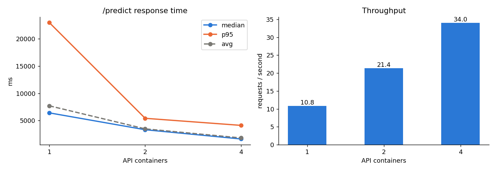

# 🌱 Bean Leaf Doctor: an end-to-end ML pipeline for bean disease detection

| | |
|---|---|
| **Video demo** | _YouTube link: add after recording_ |
| **Live app (Render)** | _https://bean-leaf-doctor.onrender.com: add your URL after deploying_ |
| **API docs** | `<app-url>/docs` (Swagger UI) |
| **GitHub** | _add repo URL_ |

## Project description

Beans feed millions of households in East Africa, and two fungal diseases,
**angular leaf spot** and **bean rust**, can wipe out 40% or more of a smallholder's harvest.
Bean Leaf Doctor lets a farmer or extension officer photograph a leaf and get an instant diagnosis
with treatment advice.

This repository is the full ML lifecycle around that model:

| Stage | Where |
|---|---|
| Data acquisition | `src/preprocessing.py → download_dataset()` downloads the iBeans dataset (Makerere AI Lab / NaCRRI, Uganda) |
| Data processing | `src/preprocessing.py` decodes, resizes to 160×160, augments, builds a stratified split and `tf.data` pipeline |
| Model creation | `src/model.py → build_model()` MobileNetV2 transfer learning + regularised head |
| Model testing | `src/model.py → evaluate()` accuracy, precision, recall, F1, ROC-AUC, log-loss, confusion matrix |
| Model retraining + triggers | `src/model.py → retrain()` and `src/api.py` (manual button, data-volume trigger, drift trigger) |
| Prediction | `src/prediction.py` |
| API | `src/api.py` (FastAPI) |
| UI | `ui/index.html`, served by the API at `/` |
| Notebook | `notebook/bean_disease_pipeline.ipynb` (executed, with all outputs) |
| Model file | `models/bean_disease_mobilenetv2.h5` |
| Load testing | `locust/` |

**Data:** non-tabular. 1,295 RGB smartphone photos of bean leaves in 3 balanced classes.
1,034 are used for training (85/15 train/validation split) and **261 are held out for testing**.

## Model results (held-out test set, 261 images)

Production model **v5** (MobileNetV2, `models/bean_disease_mobilenetv2.h5`, 25 MB):

| Metric | Value |
|---|---|
| Accuracy | 91.2% |
| Precision (macro) | 91.3% |
| Recall (macro) | 91.2% |
| F1 (macro) | 91.2% |
| ROC-AUC (one-vs-rest) | 0.984 |
| Log-loss | 0.232 |
| CPU inference | 6.5 ms / image |

| Class | Precision | Recall | F1 |
|---|---|---|---|
| angular_leaf_spot | 88.0% | 93.1% | 90.5% |
| bean_rust | 90.4% | 85.2% | 87.7% |
| healthy | 95.3% | 95.3% | 95.3% |

Confusion matrix (rows = true, cols = predicted; ALS / rust / healthy): `[[81, 5, 1], [10, 75, 3], [1, 3, 82]]`

Version history (each retrain warm-starts from the previous production model):

| Version | Trigger | Test accuracy |
|---|---|---|
| v1 | initial training | 89.7% |
| v2 | retrain with 0 new images | 89.3% |
| v3 | retrain with 36 new images | 90.4% |
| v4 | notebook training | 90.8% |
| v5 | retrain with 36 new images | 91.2% |

Most errors are leaf-spot ↔ rust confusions (the two diseases look alike in colour). Very few
diseased leaves are labelled healthy, and that's the costly mistake for a farmer.

## Data insights: three features and what they tell us

| Feature | Angular leaf spot | Bean rust | Healthy |
|---|---|---|---|
| Green-pixel ratio | 0.43 | 0.40 | **0.66** |
| Brown/lesion-pixel ratio | 0.43 | 0.41 | **0.23** |
| Brightness (0–255) | 126 | **115** | 130 |

1. **Green ratio:** healthy leaves are ~66% clearly-green pixels vs ~40% for sick ones. Disease destroys
   chlorophyll, so lost greenness is the strongest single sign of infection.
2. **Brown/lesion ratio:** diseased leaves carry ~1.8× more brown/yellow-brown pixels (lesions, pustules),
   but both diseases score about the same.
3. **Brightness:** rust photos are darker because dense, dark pustules pull luminance down. Field lighting
   also varies a lot, so we train with contrast augmentation.

**The story:** colour tells us *whether* a leaf is sick, but not *which* disease. Telling the two apart needs
spatial patterns (round rust pustules vs angular, vein-bounded lesions), which is why we use a CNN.
The dashboard's **Data insights** tab shows these distributions interactively.

## Features of the app

| Requirement | How |
|---|---|
| Model up-time | **Monitor** tab: status, up-time, health-check latency chart, per-endpoint latency (avg/p95), container id. `GET /health`, `GET /monitoring` |
| Predict one image | **Predict** tab: drag-and-drop a photo → class, confidence per class, treatment advice. `POST /predict` |
| Visualisations | **Data insights** tab: class balance, sample images, 3 feature distributions with interpretations, scatter, feature table |
| Bulk upload | **Upload & retrain** tab: many images + a label, or a `.zip` with class folders. `POST /upload` |
| Trigger retraining | **Retrain** button (`POST /retrain`), live job log (`GET /retrain/status`) |
| Evaluation in production | Upload a labelled zip → live model scored with all metrics + drift check. `POST /model/evaluate` |
| Model history | **Model** tab: metrics, confusion matrix, training curve, every version and whether it was promoted |

### How retraining works

1. Uploaded images are validated and stored in `data/uploads/<class>/`.
2. Retraining moves them into `data/train/`, **warm-starts from the current production model** (custom
   pre-trained weights), trains the head, fine-tunes, then evaluates on the untouched test set.
3. The new version is **promoted only if accuracy ≥ production − 1%**. Every version is saved in `models/versions/`
   and `models/registry.json`.
4. Every API container notices the registry change and hot-reloads the new model with no downtime.

**Retraining triggers**

- **Manual:** the *Retrain* button.
- **Data volume:** automatically once `RETRAIN_THRESHOLD` (default 30) new labelled images are waiting.
- **Performance drift:** `/model/evaluate` with *retrain on drift* ticked. If live accuracy on fresh labelled
  data drops below `DRIFT_ACCURACY_THRESHOLD` (default 0.80), those images are added and retraining starts.

`sample_data/sample_upload.zip` (36 labelled images) is included for demoing upload + auto-retrain.

## Setup

### 1. Run locally (Python 3.11)

```bash
git clone <repo-url> && cd bean_disease_pipeline
```

```bash
python3.11 -m venv .venv && source .venv/bin/activate
```

```bash
pip install -r requirements-dev.txt
```

```bash
python -m src.preprocessing      # download data + compute feature stats (≈1 min)
```

```bash
python -m src.model              # train from scratch (optional; a trained model is included)
```

```bash
uvicorn src.api:app --port 8000  # open http://localhost:8000 (UI) and /docs (API)
```

Notebook: `jupyter notebook notebook/bean_disease_pipeline.ipynb`

### 2. Run with Docker (multiple containers + load balancer)

```bash
docker compose up --build --scale api=3
```

Open http://localhost:8080. nginx round-robins across the API containers. They share the `models`
and `data` volumes, so an upload or retrain on one container is visible to all.

### 3. Deploy to Render (cloud)

1. Push this repo to GitHub (include `data/` and `models/`. The data is ~175 MB; if your Git host rejects it,
   delete `data/train` and `data/test` before pushing, and the container downloads them on first start).
2. On [render.com](https://render.com): **New → Blueprint →** select the repo. `render.yaml` creates a
   Docker web service with `/health` as its health check.
3. Wait for the build (~8 min), then open the service URL.
4. Instance size: *Starter* (512 MB) handles predictions. Retraining TensorFlow needs ≥2 GB, so pick
   *Standard* to demo retraining in the cloud. Add a persistent disk (commented in `render.yaml`) to keep
   uploads and retrained models across deploys.
5. Scaling: on paid plans, *Settings → Scaling* sets the instance count (or autoscaling on CPU), the cloud
   equivalent of `--scale api=N`.

### 4. Flood-request simulation (Locust)

```bash
bash locust/run_load_tests.sh 100 60s
```

This runs the same load (100 concurrent users, spawn rate 20/s, 60 s, 10:1 mix of `/predict` with real
leaf photos vs `/health`) against **1, 2 and 4 containers** and writes `locust/results/`.
For the interactive Locust UI: `locust -f locust/locustfile.py --host http://localhost:8080`.

## Results from the flood-request simulation

Setup: Docker Compose on a MacBook (Apple M1, 8 CPUs given to Docker). Each API container is limited to **1 CPU / 1.5 GB**,
behind an nginx round-robin load balancer. Load: **100 concurrent users** (spawned at 20/s), each sending a real leaf
photo to `/predict` every 0.5–1.5 s (plus occasional `/health`), for **60 s** per configuration.
Latency columns are for `/predict`.

|   containers |   requests |   failures |   req/s |   avg ms |   median ms |   p95 ms |   p99 ms |   max ms |
|-------------:|-----------:|-----------:|--------:|---------:|------------:|---------:|---------:|---------:|
|            1 |        598 |          0 |    10.8 |     7698 |        6400 |    23000 |    37000 |    40815 |
|            2 |       1241 |          0 |    21.4 |     3459 |        3300 |     5400 |     7400 |    10003 |
|            4 |       2009 |          1 |    34   |     1790 |        1600 |     4100 |     4900 |     7825 |



**What it shows**
- **1 container is saturated.** It handles ~11 req/s, so requests queue up: median 6.4 s, p95 23 s.
- **Throughput scales almost linearly**: 10.8 → 21.4 → 34.0 req/s (×3.1 with 4 containers).
- **Latency drops as containers are added**: median 6.4 s → 3.3 s → 1.6 s, and p95 falls from 23 s to 4.1 s.
  The long tail (p99) shrinks the most, because queues are shorter.
- **Reliability:** 1 failed request out of 3,848 (one HTTP 502 in the 4-container run while nginx was reloading).
- With 4 containers the 100-user load is still above capacity (latency well above the ~150 ms a single request takes
  when the system is idle). Production would autoscale on CPU, or add containers until p95 is under target.
  Raw Locust CSVs are in `locust/results/`.

## Repository structure

```
bean_disease_pipeline/
├── README.md
├── Dockerfile · docker-compose.yml · nginx.conf · render.yaml
├── requirements.txt · requirements-dev.txt
├── notebook/
│   ├── bean_disease_pipeline.ipynb     # executed notebook
│   └── build_notebook.py               # regenerates it
├── src/
│   ├── preprocessing.py                # acquisition, processing, features, uploads
│   ├── model.py                        # build, train, evaluate, retrain, registry
│   ├── prediction.py                   # load model + predict
│   └── api.py                          # FastAPI app, triggers, monitoring
├── ui/index.html                       # dashboard
├── data/
│   ├── train/<class>/*.jpg
│   └── test/<class>/*.jpg
├── models/
│   ├── bean_disease_mobilenetv2.h5     # production model
│   ├── metrics.json · registry.json
├── locust/ (locustfile.py, run_load_tests.sh, summarise.py, results/)
└── sample_data/sample_upload.zip
```

## API reference

| Method | Path | Purpose |
|---|---|---|
| GET | `/health` | status, up-time, model version, container |
| GET | `/monitoring` | per-endpoint request counts, avg/p50/p95/max latency |
| POST | `/predict` | one image → class + probabilities + advice |
| POST | `/predict/batch` | several images |
| POST | `/upload` | bulk images (+`label`) or a zip of class folders |
| POST | `/retrain` | start retraining (`from_scratch=true` for full training) |
| GET | `/retrain/status` | job state + live log |
| POST | `/model/evaluate` | production evaluation on labelled data + drift check |
| GET | `/model/metrics` | current metrics + version history |
| GET | `/data/stats`, `/data/scatter`, `/data/sample/{class}` | data for the visualisations |

## Dataset credit

iBeans: Makerere AI Lab and the National Crops Resources Research Institute (NaCRRI), Uganda. MIT licence.
